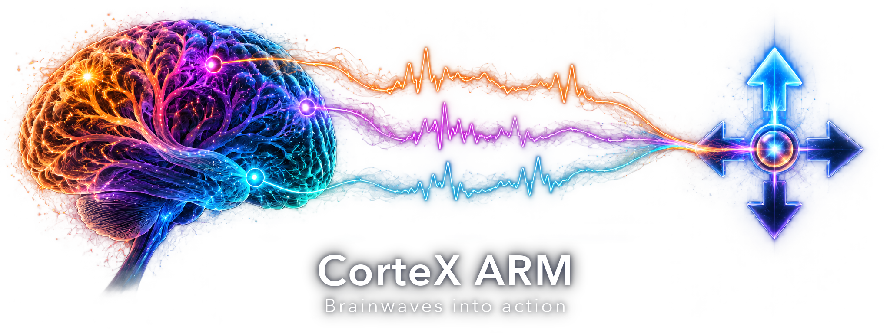
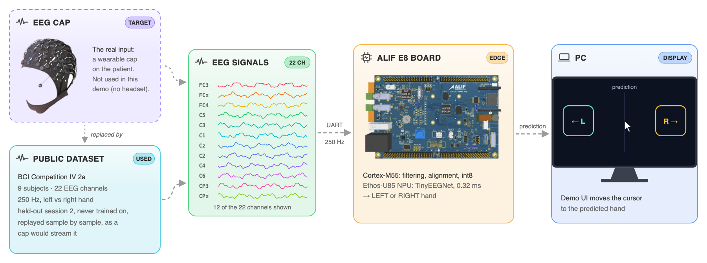

# CorteX ARM

**CorteX ARM** by team ArmExecuTorchEEG: real-time motor-imagery EEG decoding (left vs right hand) on the Alif Ensemble E8 (Cortex-M55 + Ethos-U85) with ExecuTorch. Built for the [Arm + ExecuTorch: Edge AI Challenge](https://arm-executorch.devpost.com/), San Francisco State University, October 17–18, 2026.

<picture>
<source media="(prefers-color-scheme: dark)" srcset="overview-dark.png">

</picture> Overview. No EEG cap in this demo: held-out trials from the public BCI Competition IV 2a dataset stream to the board as a cap would.

<picture>
<source media="(prefers-color-scheme: dark)" srcset="pipeline-dark.svg">

</picture> System architecture. Details, demo video and results: <a href="https://github.com/ArmExecuTorchEEG/CorteX-ARM">CorteX-ARM</a>.

**Start here: [CorteX-ARM](https://github.com/ArmExecuTorchEEG/CorteX-ARM)**, the submission: firmware, ML training code, demo UI, results and build instructions. Judged release: [`v1.0-submission`](https://github.com/ArmExecuTorchEEG/CorteX-ARM/releases/tag/v1.0-submission).

## Development Repository

### [EEG-BCI-Pipeline-Development](https://github.com/ArmExecuTorchEEG/EEG-BCI-Pipeline-Development)

Explore the EEG signal processing, neural decoding model development, embedded AI integration, firmware development, hardware validation, and engineering work behind **CorteX ARM**.

| | |
|---|---|
| Hardware | Alif Ensemble E8 DevKit: Cortex-M55 400 MHz + Ethos-U85 NPU, on-board IMU |
| Model | TinyEEGNet-wide, 3,426 parameters, 11.4 KB int8 `.pte`, all compute on the NPU |

## Live demo

 Live demo on the Alif E8. Click for the full-quality video.

## Results

| Model | Test | Accuracy | Measured on |
|---|---|---|---|
| Generic | 70 held-out trials | **77.1 %** (54/70) | physical E8 |
| Generic | 1,080 unseen trials, all 9 BCI IV 2a subjects | 74.6 % int8 | laptop, int8 reference |
| Subject-specific | subject 1, session 2 | 79.2 % int8 (114/144) | physical E8 |

| Check | Value |
|---|---|
| Model on the board = release | `.pte` read back from MRAM, sha256 matches |
| FVP = TOSA reference | 1,080/1,080 trials bit-exact |
| Inference on the Ethos-U85 | 128,056 NPU cycles ≈ 0.32 ms at 400 MHz (FVP) |
| Optimisation v0.1 → v0.5 | −43 % NPU cycles, NPU memory 237 → 124.5 KiB, accuracy 71.5 → 74.6 % |

Videos: [live demo on the E8](https://github.com/ArmExecuTorchEEG/CorteX-ARM/blob/main/docs/video/live_demo.mp4) · [from trained model to board](https://github.com/ArmExecuTorchEEG/CorteX-ARM/blob/main/docs/video/deploy_verification.mp4). Files: [`tinyeegnet_int8.pte`](https://github.com/ArmExecuTorchEEG/CorteX-ARM/releases/download/v1.0-submission/tinyeegnet_int8.pte) · [`cmsis-executorch.axf`](https://github.com/ArmExecuTorchEEG/CorteX-ARM/releases/download/v1.0-submission/cmsis-executorch.axf) · [`SHA256SUMS`](https://github.com/ArmExecuTorchEEG/CorteX-ARM/releases/download/v1.0-submission/SHA256SUMS). All numbers: [CorteX-ARM Results](https://github.com/ArmExecuTorchEEG/CorteX-ARM#results).

## Team

| Name | Role |
|---|---|
| Moamen Soliman | EEG Model Architecture, Training & Optimization |
| Philippine Chauvet | Embedded AI Engineering, Firmware & Hardware Integration |
| Cindy Ku | Frontend Engineering & UI/UX Design |
